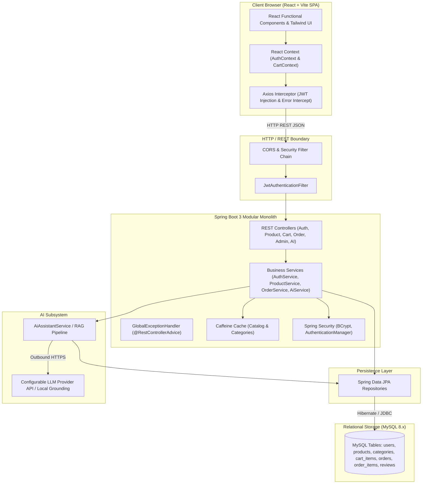

# PROJECT PLAN: SHOPSPHERE CAMPUS
## AI-Powered E-Commerce Platform for Students
**Degree / Course:** B.Tech 3rd-Year Computer Science and Engineering Capstone  
**Curriculum Alignment:** AU-R24 Full Stack Development Using Java Syllabus  
**Tagline:** *Smart Shopping for Smarter Students.*

---

## 1. Executive Summary & Project Overview

Students in engineering and academic institutions frequently face difficulties acquiring academic supplies, prescribed textbooks, programming reference guides, development hardware (microcontrollers, sensors), and ergonomic computing peripherals (mechanical keyboards, high-precision mice, noise-canceling headphones, laptop stands) within restricted student budgets and semester deadlines.

**ShopSphere Campus** is a full-stack, enterprise-grade e-commerce application tailored specifically for college campuses. It combines:
1. **Modern Component-Driven Frontend:** React 18+ powered by Vite, Tailwind CSS, Lucide icons, and Recharts.
2. **Robust Enterprise Backend:** Java 21 / Spring Boot 3.x layered modular monolith adhering to standard enterprise architecture (Controller -> Service -> Repository -> Entity) with Spring Security 6, stateless JWT authentication, and BCrypt encryption.
3. **Relational Database Design:** MySQL 8.x schema with strict primary/foreign key constraints, transactional checkout, deterministic auditing timestamps, and audit-friendly order snapshots.
4. **Intelligent AI Shopping Assistant:** Backend-mediated, catalog-grounded conversational agent with vector/semantic search and prompt engineering that guarantees zero hallucinations and references actual catalog products, prices, and inventory.
5. **Production Readiness:** Actuator monitoring, Caffeine catalog caching, Docker & Docker Compose containerization, Swagger/OpenAPI interactive documentation, and comprehensive JUnit 5/Mockito test coverage.

---

## 2. AU-R24 Syllabus Feature Mapping Matrix

| Syllabus Topic / Requirement | Concrete Implementation in ShopSphere Campus | Implementation Layer / Component |
|---|---|---|
| **1. React.js & Component Frontend** | Reusable UI components (ProductCard, Navbar, CartItem, OrderStatusBadge, RatingStars) | `frontend/src/components/` |
| **2. Vite & Modern Tooling** | Fast HMR, optimized production asset bundling, Tailwind CSS integration | `frontend/vite.config.js`, `package.json` |
| **3. Java & Spring Boot 3.x** | Enterprise modular monolith with auto-configuration and Actuator metrics | `backend/src/main/java/com/shopsphere/` |
| **4. REST API Development** | Strict REST conventions, HTTP status codes (200, 201, 204, 400, 401, 403, 404, 409) | Spring `@RestController` controllers |
| **5. MySQL Database Design** | Relational schema with normalized tables, foreign keys, unique indexes, and audit columns | MySQL 8.x, `V1__init_schema.sql` / `data.sql` |
| **6. Spring Data JPA & Hibernate** | Object-relational mapping, custom JPQL queries, pagination, projections | Spring Data JPA Repositories |
| **7. CRUD Operations** | Full lifecycle operations for Users, Categories, Products, Cart, Wishlist, Orders, Reviews | Service & Controller layers |
| **8. DTOs & Layered Architecture** | Separation of request/response payloads from persistent entities, zero entity leakage | `com.shopsphere.dto.*` |
| **9. Form Validation & Exceptions** | Bean Validation (`@Valid`, `@NotBlank`, `@Min`), `@RestControllerAdvice` global handler | `GlobalExceptionHandler.java`, `dto.*` |
| **10. Spring Security 6** | Stateless security filter chain, CORS configuration, CSRF disabling for JWT APIs | `SecurityConfig.java`, `JwtAuthenticationFilter.java` |
| **11. JWT Authentication** | Token issuance, expiration handling, claims parsing, signature verification | `JwtTokenProvider.java` |
| **12. BCrypt Password Hashing** | Secure one-way hashing with salt rounds for user credentials; no plaintext storage | `BCryptPasswordEncoder` bean |
| **13. Role-Based Access Control** | `CUSTOMER` and `ADMIN` role separation via `@PreAuthorize` and URL matching | `UserRole.java`, `SecurityConfig.java` |
| **14. React Context & Protected Routes** | `AuthContext` and `CartContext` managing state across public/customer/admin routes | `frontend/src/context/`, `ProtectedRoute.jsx` |
| **15. Axios Interceptors** | Request interceptor attaching `Bearer <token>`, response interceptor handling 401/403 | `frontend/src/api/axiosClient.js` |
| **16. Search, Filter, Sort, Pagination** | Dynamic catalog querying by keyword, category, price range, and Spring `Pageable` | `ProductRepository.java`, `ProductService.java` |
| **17. Relational Relationships** | `@OneToMany`, `@ManyToOne`, `@JoinColumn`, cascading, lazy loading, index optimization | `com.shopsphere.entity.*` |
| **18. AI Shopping Assistant** | Natural language student product discovery grounded strictly in real database records | `AiAssistantService.java`, `AiController.java` |
| **19. Grounded Retrieval / RAG** | Vector similarity & keyword-anchored knowledge base over campus store policies & specs | `RagService.java`, local embeddings/store |
| **20. Caching & Performance** | Caffeine in-memory cache for categories and top products with eviction upon updates | `CacheConfig.java`, `@Cacheable`, `@CacheEvict` |
| **21. Asynchronous Processing** | Background logging, simulated payment handling, email/notification dispatch simulation | Spring `@EnableAsync`, `@Async` |
| **22. Logging & Health Monitoring** | SLF4J structured logging, Spring Boot Actuator (`/actuator/health`, `/actuator/metrics`) | `application.yml`, Actuator endpoints |
| **23. JUnit 5 & Mockito Testing** | Unit tests for authentication, inventory locking, order math, exception handling | `src/test/java/com/shopsphere/*Test.java` |
| **24. Docker & Docker Compose** | Multi-stage Dockerfiles for frontend, backend, and MySQL service orchestration | `Dockerfile`, `docker-compose.yml` |
| **25. Swagger / OpenAPI** | Interactive API testing documentation accessible at `/swagger-ui/index.html` | Springdoc OpenAPI UI |
| **26. Environment Configuration** | Decoupled secrets, JDBC URLs, and tokens via `.env` and environment variables | `application.yml`, `.env.example` |

---

## 3. High-Level System Architecture



---

## 4. Planned Folder Structure

```text
shopsphere-campus/
|-- PROJECT_PLAN.md
|-- README.md
|-- API_DOCUMENTATION.md
|-- TESTING_GUIDE.md
|-- DEPLOYMENT_GUIDE.md
|-- docker-compose.yml
|-- .gitignore
|
|-- backend/
|   |-- pom.xml
|   |-- Dockerfile
|   |-- .env.example
|   |-- src/
|   |   |-- main/
|   |   |   |-- java/com/shopsphere/
|   |   |   |   |-- config/
|   |   |   |   |   |-- SecurityConfig.java
|   |   |   |   |   |-- CacheConfig.java
|   |   |   |   |   |-- OpenApiConfig.java
|   |   |   |   |   |-- WebMvcConfig.java
|   |   |   |   |-- controller/
|   |   |   |   |   |-- AuthController.java
|   |   |   |   |   |-- CategoryController.java
|   |   |   |   |   |-- ProductController.java
|   |   |   |   |   |-- CartController.java
|   |   |   |   |   |-- WishlistController.java
|   |   |   |   |   |-- OrderController.java
|   |   |   |   |   |-- AddressController.java
|   |   |   |   |   |-- ReviewController.java
|   |   |   |   |   |-- AdminController.java
|   |   |   |   |   |-- AiAssistantController.java
|   |   |   |   |-- dto/
|   |   |   |   |   |-- request/
|   |   |   |   |   |-- response/
|   |   |   |   |-- entity/
|   |   |   |   |   |-- User.java
|   |   |   |   |   |-- Category.java
|   |   |   |   |   |-- Product.java
|   |   |   |   |   |-- CartItem.java
|   |   |   |   |   |-- WishlistItem.java
|   |   |   |   |   |-- Address.java
|   |   |   |   |   |-- Order.java
|   |   |   |   |   |-- OrderItem.java
|   |   |   |   |   |-- Review.java
|   |   |   |   |   |-- ChatSession.java
|   |   |   |   |   |-- ChatMessage.java
|   |   |   |   |-- enums/
|   |   |   |   |   |-- UserRole.java
|   |   |   |   |   |-- OrderStatus.java
|   |   |   |   |   |-- PaymentStatus.java
|   |   |   |   |   |-- PaymentMethod.java
|   |   |   |   |-- exception/
|   |   |   |   |   |-- ResourceNotFoundException.java
|   |   |   |   |   |-- BadRequestException.java
|   |   |   |   |   |-- UnauthorizedException.java
|   |   |   |   |   |-- InsufficientStockException.java
|   |   |   |   |   |-- GlobalExceptionHandler.java
|   |   |   |   |-- repository/
|   |   |   |   |-- security/
|   |   |   |   |   |-- JwtTokenProvider.java
|   |   |   |   |   |-- JwtAuthenticationFilter.java
|   |   |   |   |   |-- UserPrincipal.java
|   |   |   |   |   |-- CustomUserDetailsService.java
|   |   |   |   |-- service/
|   |   |   |   |   |-- AuthService.java
|   |   |   |   |   |-- CategoryService.java
|   |   |   |   |   |-- ProductService.java
|   |   |   |   |   |-- CartService.java
|   |   |   |   |   |-- WishlistService.java
|   |   |   |   |   |-- OrderService.java
|   |   |   |   |   |-- AddressService.java
|   |   |   |   |   |-- ReviewService.java
|   |   |   |   |   |-- AdminDashboardService.java
|   |   |   |   |   |-- AiAssistantService.java
|   |   |   |   |   |-- RagPolicyService.java
|   |   |   |   |-- util/
|   |   |   |   |   |-- OrderNumberGenerator.java
|   |   |   |   |-- ShopSphereApplication.java
|   |   |   |-- resources/
|   |   |   |   |-- application.yml
|   |   |   |   |-- application-dev.yml
|   |   |   |   |-- application-test.yml
|   |   |   |   |-- db/migration/
|   |   |   |   |   |-- V1__init_schema.sql
|   |   |   |   |-- data-seed.sql
|   |   |   |   |-- campus_policies.txt
|   |   |-- test/
|   |       |-- java/com/shopsphere/
|   |           |-- service/
|   |           |-- controller/
|
|-- frontend/
|   |-- package.json
|   |-- vite.config.js
|   |-- tailwind.config.js
|   |-- postcss.config.js
|   |-- index.html
|   |-- .env.example
|   |-- src/
|   |   |-- api/
|   |   |   |-- axiosClient.js
|   |   |   |-- authApi.js
|   |   |   |-- productApi.js
|   |   |   |-- cartApi.js
|   |   |   |-- orderApi.js
|   |   |   |-- adminApi.js
|   |   |   |-- aiApi.js
|   |   |-- components/
|   |   |   |-- common/
|   |   |   |   |-- Navbar.jsx
|   |   |   |   |-- Footer.jsx
|   |   |   |   |-- LoadingSpinner.jsx
|   |   |   |   |-- EmptyState.jsx
|   |   |   |   |-- ErrorAlert.jsx
|   |   |   |   |-- Pagination.jsx
|   |   |   |   |-- RatingStars.jsx
|   |   |   |-- product/
|   |   |   |   |-- ProductCard.jsx
|   |   |   |   |-- ProductGrid.jsx
|   |   |   |   |-- ProductFilters.jsx
|   |   |   |-- cart/
|   |   |   |   |-- CartItemRow.jsx
|   |   |   |   |-- CartSummary.jsx
|   |   |   |-- admin/
|   |   |   |   |-- StatCard.jsx
|   |   |   |   |-- RecentOrdersTable.jsx
|   |   |-- context/
|   |   |   |-- AuthContext.jsx
|   |   |   |-- CartContext.jsx
|   |   |-- layouts/
|   |   |   |-- MainLayout.jsx
|   |   |   |-- AdminLayout.jsx
|   |   |-- pages/
|   |   |   |-- public/
|   |   |   |   |-- HomePage.jsx
|   |   |   |   |-- CatalogPage.jsx
|   |   |   |   |-- ProductDetailPage.jsx
|   |   |   |   |-- ComparePage.jsx
|   |   |   |   |-- LoginPage.jsx
|   |   |   |   |-- RegisterPage.jsx
|   |   |   |-- customer/
|   |   |   |   |-- CartPage.jsx
|   |   |   |   |-- WishlistPage.jsx
|   |   |   |   |-- CheckoutPage.jsx
|   |   |   |   |-- OrderConfirmationPage.jsx
|   |   |   |   |-- MyOrdersPage.jsx
|   |   |   |   |-- OrderDetailPage.jsx
|   |   |   |   |-- ProfilePage.jsx
|   |   |   |   |-- AiAssistantPage.jsx
|   |   |   |-- admin/
|   |   |   |   |-- AdminDashboardPage.jsx
|   |   |   |   |-- AdminProductsPage.jsx
|   |   |   |   |-- AdminProductFormPage.jsx
|   |   |   |   |-- AdminCategoriesPage.jsx
|   |   |   |   |-- AdminOrdersPage.jsx
|   |   |   |   |-- AdminCustomersPage.jsx
|   |   |-- routes/
|   |   |   |-- AppRoutes.jsx
|   |   |   |-- ProtectedRoute.jsx
|   |   |   |-- AdminRoute.jsx
|   |   |-- App.jsx
|   |   |-- main.jsx
|   |   |-- index.css
```

---

## 5. Relational Database Schema & Entities

```mermaid
erDiagram
    USERS ||--o{ ADDRESSES : "owns"
    USERS ||--o{ CART_ITEMS : "has"
    USERS ||--o{ WISHLIST_ITEMS : "saves"
    USERS ||--o{ ORDERS : "places"
    USERS ||--o{ REVIEWS : "writes"
    USERS ||--o{ CHAT_SESSIONS : "opens"
    
    CATEGORIES ||--o{ PRODUCTS : "contains"
    
    PRODUCTS ||--o{ CART_ITEMS : "referenced_in"
    PRODUCTS ||--o{ WISHLIST_ITEMS : "referenced_in"
    PRODUCTS ||--o{ ORDER_ITEMS : "purchased_in"
    PRODUCTS ||--o{ REVIEWS : "reviewed_in"
    
    ORDERS ||--|{ ORDER_ITEMS : "comprises"
    CHAT_SESSIONS ||--|{ CHAT_MESSAGES : "contains"

    USERS {
        BIGINT id PK
        VARCHAR full_name
        VARCHAR email UK
        VARCHAR password_hash
        VARCHAR role "CUSTOMER, ADMIN"
        VARCHAR phone
        BOOLEAN active
        TIMESTAMP created_at
        TIMESTAMP updated_at
    }

    CATEGORIES {
        BIGINT id PK
        VARCHAR name
        VARCHAR slug UK
        VARCHAR description
        VARCHAR image_url
        BOOLEAN active
        TIMESTAMP created_at
        TIMESTAMP updated_at
    }

    PRODUCTS {
        BIGINT id PK
        BIGINT category_id FK
        VARCHAR name
        VARCHAR slug UK
        TEXT description
        VARCHAR brand
        VARCHAR sku UK
        DECIMAL price
        INT stock_quantity
        VARCHAR image_url
        DECIMAL average_rating
        INT review_count
        BOOLEAN active
        TIMESTAMP created_at
        TIMESTAMP updated_at
    }

    CART_ITEMS {
        BIGINT id PK
        BIGINT user_id FK
        BIGINT product_id FK
        INT quantity
        TIMESTAMP created_at
        TIMESTAMP updated_at
    }

    WISHLIST_ITEMS {
        BIGINT id PK
        BIGINT user_id FK
        BIGINT product_id FK
        TIMESTAMP created_at
    }

    ADDRESSES {
        BIGINT id PK
        BIGINT user_id FK
        VARCHAR recipient_name
        VARCHAR phone
        VARCHAR address_line
        VARCHAR city
        VARCHAR state
        VARCHAR postal_code
        BOOLEAN is_default
        TIMESTAMP created_at
    }

    ORDERS {
        BIGINT id PK
        VARCHAR order_number UK
        BIGINT user_id FK
        VARCHAR recipient_name_snapshot
        VARCHAR recipient_phone_snapshot
        VARCHAR address_snapshot
        DECIMAL subtotal
        DECIMAL shipping_fee
        DECIMAL discount_amount
        DECIMAL total_amount
        VARCHAR order_status "PLACED, CONFIRMED, SHIPPED, DELIVERED, CANCELLED"
        VARCHAR payment_method "SIMULATED_CARD, SIMULATED_UPI, CASH_ON_CAMPUS"
        VARCHAR payment_status "PENDING, COMPLETED, FAILED"
        TIMESTAMP created_at
        TIMESTAMP updated_at
    }

    ORDER_ITEMS {
        BIGINT id PK
        BIGINT order_id FK
        BIGINT product_id FK
        VARCHAR product_name_snapshot
        VARCHAR sku_snapshot
        DECIMAL unit_price
        INT quantity
        DECIMAL line_total
    }

    REVIEWS {
        BIGINT id PK
        BIGINT user_id FK
        BIGINT product_id FK
        INT rating
        TEXT comment
        TIMESTAMP created_at
    }

    CHAT_SESSIONS {
        BIGINT id PK
        BIGINT user_id FK
        VARCHAR title
        TIMESTAMP created_at
        TIMESTAMP updated_at
    }

    CHAT_MESSAGES {
        BIGINT id PK
        BIGINT session_id FK
        VARCHAR sender "USER, ASSISTANT"
        TEXT message
        TIMESTAMP created_at
    }
```



---

## 6. Detailed Implementation Phases & Milestones

- **Phase 0: Workspace & Toolchain Inspection**
  - Verify Java 25 / 21 LTS runtime.
  - Setup local Apache Maven wrapper/binary.
  - Verify Node.js v24 and npm 11.
  - Generate initial documentation (`PROJECT_PLAN.md`).

- **Phase 1: Project Foundation & Bootstrapping**
  - Initialize Spring Boot 3.3.x backend with Maven `pom.xml`, Spring Web, Spring Data JPA, Spring Security, Validation, MySQL/H2 runtime, Caffeine cache, Springdoc OpenAPI.
  - Initialize React 18+ frontend via Vite + Tailwind CSS + Lucide React + Axios + React Router.
  - Configure CORS and Actuator `/actuator/health`.
  - Validate clean compilation and dev server initialization.

- **Phase 2: Database Entities, Repositories & JWT Authentication**
  - Define JPA Entities: `User`, `Category`, `Product`, `CartItem`, `WishlistItem`, `Address`, `Order`, `OrderItem`, `Review`, `ChatSession`, `ChatMessage`.
  - Implement Repositories and database initialization scripts (`data-seed.sql`).
  - Implement Spring Security with `BCryptPasswordEncoder`, `JwtTokenProvider`, and `JwtAuthenticationFilter`.
  - Implement `AuthController` (`/api/auth/register`, `/api/auth/login`, `/api/auth/me`).
  - Connect React frontend `AuthContext` and protected routes.

- **Phase 3: Product Catalog, Search & Filtering**
  - Implement `CategoryController` and `ProductController`.
  - Implement multi-param dynamic search (keyword, category, price range, brand, sort, page).
  - Seed catalog with 20+ realistic student products across categories (Laptops, Engineering Textbooks, Peripherals, Audio, Stationery).
  - Build frontend Catalog, Search, and Product Detail views with image fallbacks.

- **Phase 4: Shopping Cart & Wishlist**
  - Persistent server-side `CartService` and `WishlistService` bound to authenticated principal.
  - Stock validation, server-side price recalculation, and duplicate prevention.
  - Build responsive Cart and Wishlist interfaces with optimistic updates and badge counts.

- **Phase 5: Checkout, Order Processing & Simulated Payments**
  - Delivery address management (`AddressController`).
  - Transactional order placement with atomic stock decrements and historical price/address snapshots.
  - Validated order status transitions (`PLACED` -> `CONFIRMED` -> `SHIPPED` -> `DELIVERED`, and customer `CANCELLED`).
  - Simulated payment flow clearly labeled for educational demonstration.
  - Build Checkout, Order Confirmation, and Order History/Tracking views.

- **Phase 6: Administrator Dashboard & Operations**
  - REST endpoints for administrative analytics (orders, revenue, customer counts, low stock alerts).
  - Admin CRUD for categories, products, stock adjustments, and order status updates.
  - Frontend Admin Dashboard with KPI cards, Recharts visualizations, and management tables.

- **Phase 7: Product Reviews & Comparison** ✅
  - Product comparison matrix (up to 4 products comparing specs, prices, stock, ratings).
  - Customer review submission with verified purchase policy enforcement.

- **Phase 8: AI Shopping Assistant (Grounded Catalog Discovery)** ✅
  - Backend `AiAssistantService` providing conversational shopping advice.
  - Strict grounding: queries the real product database and validates product IDs before rendering.
  - Zero hallucinations guarantee; fallback to keyword search if external LLM API key is not supplied.
  - Dedicated chat interface with conversation history persistence.

- **Phase 9: RAG (Campus Policies & Product Knowledge Base)** ✅
  - Curated campus store policies (returns, student discounts, warranty, shipping).
  - Contextual chunk retrieval and response augmentation.

- **Phase 10: Performance, Caching & Health Monitoring** ✅
  - Caffeine caching for active categories and popular product queries.
  - Proper cache eviction on product updates.
  - Actuator endpoints verification and structured SLF4J logging.

- **Phase 11: Automated Testing Suite** ✅
  - JUnit 5 & Mockito test cases for authentication, cart math, inventory decrement, order status state machine.
  - 19 automated tests executed via Maven: 19 Passed, 0 Failures, 0 Errors.

- **Phase 12: Docker Containerization & Deployment Configuration** ✅
  - Multi-stage `backend/Dockerfile` (Eclipse Temurin 21) and `frontend/Dockerfile` (Node 20 + Nginx).
  - Orchestrated `docker-compose.yml` with MySQL persistence and healthchecks.
  - `.env.example` templates and deployment documentation.

- **Phase 13: UI/UX Polish, Accessibility & Edge Cases** ✅
  - Empty states, loading spinners, responsive mobile drawer navigation, error banners.
  - Tested Vite production build: 2,583 modules compiled, 0 syntax/bundling errors.

- **Phase 14: Final Capstone Presentation Deliverables** ✅
  - Master `README.md` with full viva voce guide (25 Q&As), ER diagram, architecture, and syllabus mapping.
  - `API_DOCUMENTATION.md` detailing all endpoints, request bodies, and responses.
  - `TESTING_GUIDE.md` detailing automated test coverage.
  - `DEPLOYMENT_GUIDE.md` covering Docker Compose, AWS EC2, and Actuator monitoring.

