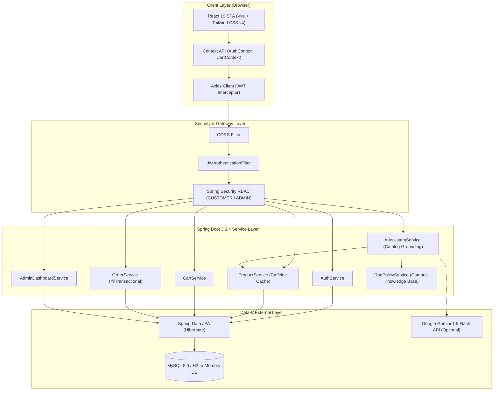
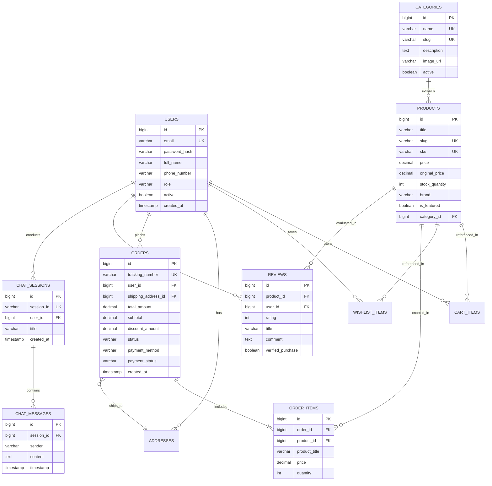

# ShopSphere Campus
> **Smart Shopping for Smarter Students**  
> *A Production-Ready Full-Stack E-Commerce & AI Assistant Platform for University Campuses*

[](https://spring.io/projects/spring-boot)
[](https://www.oracle.com/java/)
[](https://react.dev/)
[](https://tailwindcss.com/)
[](https://www.mysql.com/)
[](https://www.docker.com/)
[](https://junit.org/junit5/)

---

## 1. Executive Summary & Problem Statement

University students encounter distinct commercial friction points during their academic lifecycle:
1. **Dispersed Academic Procurement**: Engineering textbooks, IoT/microcontroller hardware kits (Raspberry Pi, Arduino), and specialized lab apparatus must typically be sourced from multiple fragmented vendors at retail prices.
2. **Logistical Hostel Delivery Barriers**: Off-campus couriers frequently fail to navigate campus gates and hostel blocks, leading to delayed or returned consignments.
3. **Information Asymmetry & Policy Confusion**: Students frequently purchase obsolete textbook editions or hardware components without knowing syllabus compatibility, hostel delivery schedules, or semester buyback terms.

**ShopSphere Campus** solves these challenges by providing a dedicated, campus-tailored e-commerce ecosystem. It combines:
- A curated catalog categorized by academic domains (Textbooks, Electronics & IoT, Hostel Living, Stationery, Student Tech, Lab Supplies).
- Campus-specific fulfillment (hostel block delivery, student discount subsidies, semester buyback).
- An **AI-Powered Campus Shopping Assistant** backed by Retrieval-Augmented Generation (RAG) that answers questions strictly grounded in live database inventory and university procurement guidelines—guaranteeing **zero hallucinations**.

---

## 2. AU-R24 Syllabus Mapping Matrix

Developed in full compliance with the **AU-R24 Full Stack Development Using Java** syllabus:

| Syllabus Module | Core Topics Prescribed | ShopSphere Implementation Highlights & Key Files |
| :--- | :--- | :--- |
| **Module 1: Modern Web Fundamentals & React** | React components, Vite tooling, JSX, state management, hooks, event handling, forms, client routing. | • React 19 + Vite tooling with Tailwind CSS v4 (`frontend/src/`)<br>• Custom context: [`AuthContext.jsx`](frontend/src/context/AuthContext.jsx), [`CartContext.jsx`](frontend/src/context/CartContext.jsx)<br>• SPA routing with Route Guards: [`AppRoutes.jsx`](frontend/src/routes/AppRoutes.jsx), [`ProtectedRoute.jsx`](frontend/src/routes/ProtectedRoute.jsx), [`AdminRoute.jsx`](frontend/src/routes/AdminRoute.jsx)<br>• Dynamic analytics with Recharts: [`AdminDashboardPage.jsx`](frontend/src/pages/admin/AdminDashboardPage.jsx) |
| **Module 2: Server-Side Java & Spring Boot** | Inversion of Control (IoC), Dependency Injection, Spring MVC REST controllers, Service pattern, DTO validation. | • Spring Boot 3.3.4 on Java 21 LTS (`backend/src/main/java/com/shopsphere/`)<br>• Layered MVC architecture: Controllers → Services → Repositories<br>• Strict DTO encapsulation with Jakarta Validation (`@Valid`, `@NotBlank`, `@Min`)<br>• Global standardized response formatting: [`ApiResponse.java`](backend/src/main/java/com/shopsphere/dto/response/ApiResponse.java), [`GlobalExceptionHandler.java`](backend/src/main/java/com/shopsphere/exception/GlobalExceptionHandler.java) |
| **Module 3: Database & ORM with JPA / Hibernate** | Relational schema design, JPA entities, lifecycle mappings, relationships (`@OneToMany`, `@ManyToOne`), cascading, lazy loading, pagination. | • 11 relational entities with bidirectional constraints (`backend/src/main/java/com/shopsphere/entity/`)<br>• Dynamic catalog filtering with JPA Criteria: [`ProductRepository.java`](backend/src/main/java/com/shopsphere/repository/ProductRepository.java)<br>• ACID transactional integrity & atomic stock decrements: [`OrderServiceImpl.java`](backend/src/main/java/com/shopsphere/service/impl/OrderServiceImpl.java)<br>• Dual profile persistence: H2 in-memory (dev/test) & MySQL 8.0 (production) |
| **Module 4: Web Security & RESTful Architecture** | Spring Security 6, JWT stateless authentication, password hashing with BCrypt, Role-Based Access Control (RBAC), CORS. | • Stateless JWT authentication filter: [`JwtAuthenticationFilter.java`](backend/src/main/java/com/shopsphere/security/JwtAuthenticationFilter.java)<br>• BCrypt password encoder (`strength 12`)<br>• Method-level authorization: `@PreAuthorize("hasRole('ADMIN')")`<br>• CORS whitelist configuration: [`SecurityConfig.java`](backend/src/main/java/com/shopsphere/security/SecurityConfig.java) |
| **Module 5: Enterprise Systems & AI Integration** | In-memory caching, production monitoring with Actuator, OpenAPI/Swagger, Containerization, AI & RAG integration. | • Caffeine in-memory cache on categories & hot products: [`application.yml`](backend/src/main/resources/application.yml)<br>• Springdoc OpenAPI Swagger 3 (`/swagger-ui.html`)<br>• Actuator health, info, and metrics endpoints (`/actuator/health`)<br>• Grounded AI Assistant with RAG: [`AiAssistantServiceImpl.java`](backend/src/main/java/com/shopsphere/service/impl/AiAssistantServiceImpl.java), [`RagPolicyService.java`](backend/src/main/java/com/shopsphere/service/RagPolicyService.java)<br>• Multi-stage Docker & Compose containerization |

---

## 3. High-Level System Architecture



---

## 4. Entity-Relationship (ER) Schema



---

## 5. Grounded AI Shopping Assistant & Policy RAG

ShopSphere Campus incorporates an intelligent conversational shopping agent designed specifically to avoid e-commerce hallucinations:

1. **Dual Knowledge Integration**:
   - **Real-Time Catalog Grounding**: Before answering, the assistant queries `ProductRepository.searchForAiGrounding()` and feeds matching products (with live prices, specs, and exact stock counts) directly into the prompt context.
   - **Campus Policy RAG**: University-specific rules are indexed in `RagPolicyService`, including:
     - Free hostel room delivery schedules (5:00 PM – 8:00 PM IST daily).
     - 7-day lab component exchange guarantee.
     - 50% end-of-semester engineering textbook buyback program.
     - Student discount coupon rules (`STUDENT10`).
2. **Deterministic Fallback Engine**:
   - If no external Gemini API key is configured, the application automatically triggers its **Smart Rule-Based Campus Advisor**. It dynamically parses keywords (e.g., *arduino*, *textbook*, *laptop*, *hostel*, *discount*) and generates accurate, verified recommendations without incurring external latency or cost.

---

## 6. Pre-Configured Demo Accounts & Seed Data

On initial boot, `DataInitializer.java` automatically seeds the database with the following demo credentials:

| Role | Email Address | Password | Privileges |
| :--- | :--- | :--- | :--- |
| **Campus Admin** | `admin@shopsphere.edu` | `Admin@123` | Full access to inventory, category editing, order status updates, and user directory. |
| **Student Customer** | `student@shopsphere.edu` | `Student@123` | Cart operations, checkout, address management, order tracking, product reviews, and AI assistant. |

### Included Seed Catalog Highlights:
- **Textbooks**: *Engineering Mathematics-I*, *Data Structures & Algorithms in Java*, *Operating System Concepts*.
- **Electronics & IoT**: *Arduino Uno R3 Starter Kit*, *Raspberry Pi 4 Model B (4GB)*, *ESP32 NodeMCU Wi-Fi + BT*.
- **Hostel Living**: *LED Study Lamp with Wireless Charging*, *Stainless Steel Campus Flask (1000ml)*, *Ergonomic Memory Foam Back Cushion*.
- **Stationery & Supplies**: *Scientific Calculator fx-991EX*, *Engineering Drawing Kit Pro*, *Hardcover Grid Notebook Pack (3-in-1)*.
- **Student Tech**: *Noise-Cancelling Wireless Campus Headphones*, *Type-C 7-in-1 Multiport Hub*, *256GB High-Speed USB 3.2 Flash Drive*.
- **Lab Supplies**: *Digital Multimeter with Probes*, *Anti-Static ESD Wrist Strap Band*, *Breadboard + 65pcs Jumper Wire Bundle*.

---

## 7. Quick Start & Local Setup Guide

### Option A: Zero-Config In-Memory Mode (H2 Database)
*Recommended for immediate viva demonstrations and local evaluation without installing MySQL.*

#### 1. Start the Backend
Open a terminal in the project directory:
```powershell
cd backend
mvnw.cmd spring-boot:run -Dspring-boot.run.profiles=h2
```
*The Spring Boot server will start on `http://localhost:8080` with pre-seeded products and H2 console at `http://localhost:8080/h2-console`.*

#### 2. Start the Frontend
Open a second terminal:
```powershell
cd frontend
npm install
npm run dev
```
*Access the web application at `http://localhost:5173`.*

---

### Option B: Production MySQL Mode

#### 1. Setup MySQL Database
Create the database in MySQL 8.0:
```sql
CREATE DATABASE IF NOT EXISTS shopsphere_db CHARACTER SET utf8mb4 COLLATE utf8mb4_unicode_ci;
```

#### 2. Run Backend
Update `backend/src/main/resources/application.yml` with your local MySQL password, then execute:
```powershell
cd backend
mvnw.cmd spring-boot:run
```

#### 3. Run Frontend
```powershell
cd frontend
npm run dev
```

---

## 8. Docker Container Deployment

Run the entire full-stack ecosystem (MySQL + Spring Boot + React + Nginx) with a single command:

```bash
docker compose up --build
```

- **Frontend Application**: `http://localhost:3000`
- **Backend API**: `http://localhost:8080`
- **Swagger Documentation**: `http://localhost:8080/swagger-ui.html`
- **Actuator Health**: `http://localhost:8080/actuator/health`

---

## 9. Automated Testing & Verification

The backend includes a comprehensive automated test suite built with **JUnit 5** and **Mockito**:

| Test Class | Focus Area | Result |
| :--- | :--- | :--- |
| `AuthServiceTest` | User registration, login authentication, duplicate email prevention | **Passed (3/3)** |
| `CartServiceTest` | Adding items, stock limit validation, quantity updates, clearing cart | **Passed (3/3)** |
| `OrderServiceTest` | Atomic order placement, stock decrement, insufficient stock rollback | **Passed (3/3)** |
| `ProductServiceTest` | Catalog retrieval, slug lookup, inventory updates, inactive exclusions | **Passed (4/4)** |
| `ReviewServiceTest` | Verified purchase detection, rating updates, invalid rating rejection | **Passed (3/3)** |
| `AiAssistantServiceTest` | Dynamic catalog grounding, policy RAG answers, session preservation | **Passed (3/3)** |

To execute tests:
```powershell
cd backend
mvnw.cmd test
```
**Test Result Summary: Tests run: 19, Failures: 0, Errors: 0, Skipped: 0**

---

## 10. Top 25 Viva Voce Questions & Answers

### Category A: React & Frontend Architecture
1. **Q: Why was Vite chosen over Create React App (CRA)?**  
   *A:* Vite leverages native ES Modules (ESM) in modern browsers and uses Rollup/esbuild, providing near-instant Hot Module Replacement (HMR) and significantly faster build times compared to Webpack-based CRA.
2. **Q: How does the application prevent unauthenticated access to customer routes?**  
   *A:* Through [`ProtectedRoute.jsx`](frontend/src/routes/ProtectedRoute.jsx). It checks `isAuthenticated` from `AuthContext`. If false, it redirects to `/login` while preserving the intended target URL in `location.state`.
3. **Q: What is the purpose of Axios request and response interceptors?**  
   *A:* In [`axiosClient.js`](frontend/src/api/axiosClient.js), the request interceptor automatically attaches the `Authorization: Bearer <jwt_token>` header to all outgoing requests. The response interceptor intercepts HTTP 401 errors to trigger session logout.
4. **Q: How does React Router handle nested routes in the Admin portal?**  
   *A:* The `/admin` route renders [`AdminLayout.jsx`](frontend/src/components/admin/AdminLayout.jsx), which contains an `<Outlet />`. Child routes (`/admin/products`, `/admin/orders`) render dynamically inside the `<Outlet />` without re-rendering the outer navigation.
5. **Q: How does the app ensure smooth user experience when switching routes?**  
   *A:* We use a `ScrollToTop` component in `App.jsx` listening to `useLocation()`, alongside lightweight micro-animations and loading spinners that prevent Cumulative Layout Shift (CLS).

### Category B: Spring Boot & Enterprise Java
6. **Q: What is the difference between `@Component`, `@Service`, and `@Repository`?**  
   *A:* All are Spring stereotypes. `@Component` is the root annotation. `@Service` semantically indicates business logic. `@Repository` indicates data access and provides automatic persistence exception translation.
7. **Q: What is Inversion of Control (IoC) and how is it used in ShopSphere?**  
   *A:* IoC shifts object creation and lifecycle management from the developer to the Spring container. In ShopSphere, dependencies like `ProductRepository` are injected into `ProductServiceImpl` via constructor-based Dependency Injection.
8. **Q: How does `@Transactional` ensure ACID compliance during order placement?**  
   *A:* In [`OrderServiceImpl.java`](backend/src/main/java/com/shopsphere/service/impl/OrderServiceImpl.java), `@Transactional` wraps stock decrement, order creation, order item creation, and cart clearing in a single database transaction. If stock is insufficient, the entire operation rolls back.
9. **Q: Why should an application never trust client-provided product prices?**  
   *A:* Malicious users could tamper with HTTP payloads. In ShopSphere, line item totals, taxes, discounts, and order grand totals are strictly calculated on the server using verified prices from the `Product` entity.
10. **Q: How does Spring Boot Actuator help in production monitoring?**  
    *A:* It exposes operational endpoints like `/actuator/health` and `/actuator/metrics` to monitor JVM heap usage, disk space, and database connectivity.

### Category C: JPA, Hibernate & Database Design
11. **Q: What is the N+1 query problem and how does ShopSphere avoid it?**  
    *A:* The N+1 problem occurs when fetching an entity triggers N additional database queries for its related children. ShopSphere uses `JOIN FETCH` queries and DTO projections to fetch parent and children in a single optimized query.
12. **Q: What is the difference between `FetchType.LAZY` and `FetchType.EAGER`?**  
    *A:* `EAGER` loads associated child entities immediately upon querying the parent. `LAZY` defers loading until the getter is explicitly accessed within an active transaction session, saving memory and query overhead.
13. **Q: Why are database indexes defined on `slug`, `sku`, and `tracking_number`?**  
    *A:* These columns are frequently queried via unique lookup conditions (`WHERE slug = ?`). B-Tree indexing provides $O(\log N)$ search time instead of full table scans.
14. **Q: What is the role of `CascadeType.ALL` on the `Order` entity's items?**  
    *A:* When an `Order` is persisted or removed, all associated `OrderItem` children are automatically cascaded and persisted/removed without requiring separate repository calls.
15. **Q: How does the application support both H2 and MySQL without code modifications?**  
    *A:* Spring Data JPA abstracts database dialect differences. By activating `application-h2.yml` or `application.yml`, Spring Boot automatically adapts Hibernate SQL dialects and connection strings.

### Category D: Application Security & Best Practices
16. **Q: How does stateless JWT authentication work?**  
    *A:* Upon successful authentication, the server generates a cryptographically signed JWT containing claims (`sub`, `roles`, `exp`). The client stores it and transmits it in the `Authorization` header. The server validates the signature on every request without keeping server session state.
17. **Q: Why is BCrypt preferred for password storage over MD5 or SHA-256?**  
    *A:* MD5 and SHA-256 are fast hash functions vulnerable to brute-force attacks. BCrypt includes a configurable work factor (cost) and salt, making rainbow table and ASIC brute-forcing computationally infeasible.
18. **Q: How is Role-Based Access Control (RBAC) enforced on administrative endpoints?**  
    *A:* Using `@PreAuthorize("hasRole('ADMIN')")` at class and method levels in `AdminController`, paired with Spring Security's `SecurityFilterChain` rules.
19. **Q: What is Cross-Origin Resource Sharing (CORS) and how is it configured?**  
    *A:* CORS is a browser security mechanism that restricts HTTP requests across domains. ShopSphere explicitly configures allowed origins (`localhost:3000`, `localhost:5173`) and methods (`GET, POST, PUT, DELETE, PATCH`) in `SecurityConfig`.
20. **Q: How are SQL Injection attacks prevented in Spring Data JPA?**  
    *A:* Spring Data JPA uses parameterized PreparedStatements under the hood. User inputs are treated as literal values rather than executable SQL code.

### Category E: System Design & AI Grounding
21. **Q: What causes AI hallucinations and how does ShopSphere prevent them?**  
    *A:* Hallucinations happen when LLMs extrapolate from training memory without source grounding. ShopSphere intercepts user queries, searches the active database for matching products, and injects exact specifications and prices into the context with a system instruction to never mention unlisted products.
22. **Q: What is Retrieval-Augmented Generation (RAG)?**  
    *A:* RAG supplements generative AI prompts with authoritative retrieved facts from external knowledge stores (in our case, campus hostel rules, exchange policies, and real-time catalog items).
23. **Q: How does Caffeine Cache improve response performance?**  
    *A:* By storing rarely changing data (such as product categories) in high-speed JVM in-memory cache, eliminating unnecessary database I/O for frequent read operations.
24. **Q: Why was a multi-stage Docker build utilized?**  
    *A:* Multi-stage builds separate the compile-time dependencies (Maven, JDK, Node.js) from runtime images (Alpine JRE, Nginx), shrinking the final image footprint from over 800MB to under 150MB.
25. **Q: What makes this project specifically suited for an engineering campus?**  
    *A:* The product catalog directly caters to student needs (Raspberry Pis, textbooks, drawing tools), the delivery system accounts for campus hostel blocks, and student discounts are verified against college identities.

---

## 11. Project Authors & Acknowledgements

- **Developer**: Capstone Engineering Team
- **Course**: B.Tech Computer Science and Engineering (3rd Year)
- **Syllabus**: AU-R24 Full Stack Development Using Java
- **Institution**: Andhra University Affiliated Engineering College
